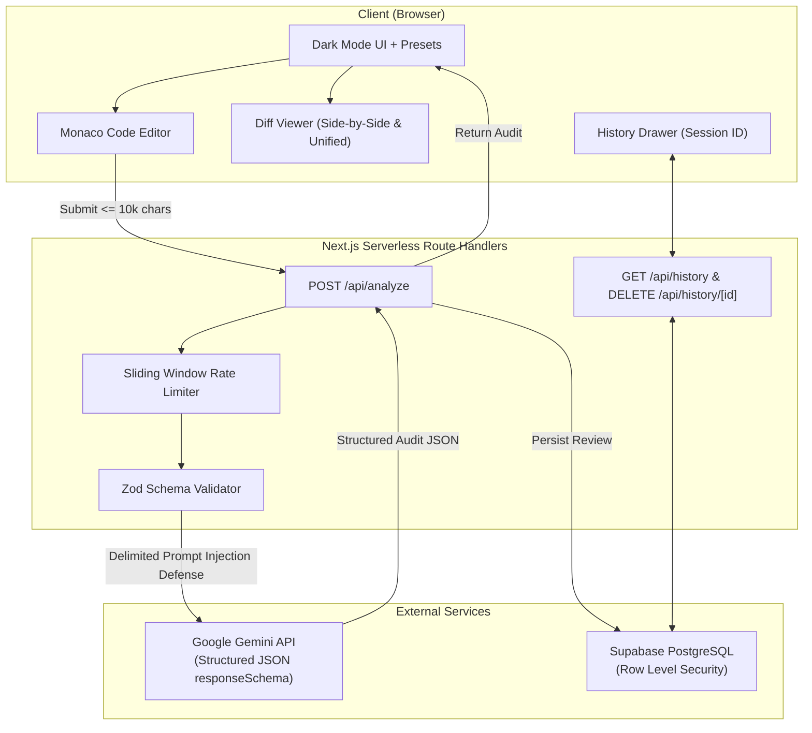

# AI Code Reviewer & Security Linter 🛡️⚡

An enterprise-grade, student-friendly web application designed to help developers write secure, performant, and idiomatic code. Users paste code snippets and receive an instant OWASP/CWE security audit, beginner-friendly explanations with educational tooltips, an idiomatic refactored version with side-by-side diffing, and persistent review history.

---

## 🚀 Key Features

- **Instant Security & Performance Audit**: Flags SQL injection, XSS, OS command injection, hardcoded secrets, weak crypto, unsafe eval, race conditions, memory leaks, and quadratic ($O(N^2)$) loops.
- **OWASP & CWE Mapping**: Automatically correlates findings with industry standards (e.g., CWE-89, CWE-79, CWE-78, OWASP Top 10).
- **Monaco Code Editor**: Full-featured code editor with syntax highlighting, language selector (Python, JS/TS, Java, C/C++, PHP, SQL, Go, Auto-detect), and 10,000-character input validation.
- **Interactive Line Highlighting**: Clicking any issue card instantly scrolls Monaco to the offending lines and applies highlighted gutter markers.
- **Side-by-Side & Unified Diff Viewer**: Visualizes exact code improvements with side-by-side comparison, unified diff, refactoring justifications, and 1-click clipboard copy or "Apply to Editor".
- **Educational Tooltips**: Hover or tap badges and security terminology to read beginner-friendly definitions without confusing jargon.
- **Preset Vulnerability Demonstrations**: 1-click presets for SQL Injection, XSS, Command Injection, Hardcoded Secrets, Inefficient Loops, and Clean Code.
- **Persistent Audit History**: Automatically stores reviews in Supabase PostgreSQL using client session IDs (`x-session-id`) with Row Level Security (RLS).
- **Security-First Architecture**:
  - Delimiter encapsulation (`<<<USER_UNTRUSTED_CODE>>>`) prevents prompt injection attacks.
  - In-memory sliding window rate limiting (10 req/min per IP/session).
  - Serverless timeouts configured with `maxDuration = 60` for Vercel.
  - All secret keys strictly isolated on the server.

---

## 🛠️ Tech Stack

- **Framework**: [Next.js](https://nextjs.org/) (App Router) + [React](https://react.dev/)
- **Language**: [TypeScript](https://www.typescriptlang.org/) (Strict mode)
- **Styling**: [Tailwind CSS](https://tailwindcss.com/) (Developer-first Dark Mode)
- **Editor**: [@monaco-editor/react](https://github.com/suren-atoyan/monaco-react)
- **AI Engine**: [Google Gemini API](https://ai.google.dev/) (`gemini-2.5-flash` with structured JSON schema)
- **Validation**: [Zod](https://zod.dev/)
- **Database**: [Supabase](https://supabase.com/) (PostgreSQL with Row Level Security)
- **Diffing**: [diff](https://github.com/kpdecker/jsdiff)
- **Icons**: [Lucide React](https://lucide.dev/)
- **Deployment**: [Vercel](https://vercel.com/)

---

## 🏗️ Architecture & Data Flow



---

## ⚡ Quick Start (Local Setup)

### 1. Clone the repository
```bash
git clone https://github.com/your-username/ai-code-reviewer.git
cd ai-code-reviewer
```

### 2. Install dependencies
```bash
npm install
```

### 3. Configure environment variables
Copy `.env.example` to `.env.local`:
```bash
cp .env.example .env.local
```
Fill in your credentials:
```env
# Google Gemini API Key (Get from https://aistudio.google.com/)
GEMINI_API_KEY="your-gemini-api-key"
GEMINI_MODEL="gemini-2.5-flash"

# Supabase PostgreSQL Configuration (Get from https://supabase.com/)
NEXT_PUBLIC_SUPABASE_URL="https://your-project.supabase.co"
NEXT_PUBLIC_SUPABASE_ANON_KEY="your-supabase-anon-key"
SUPABASE_SERVICE_ROLE_KEY="your-supabase-service-role-key"
```

> **Note**: Even without a `GEMINI_API_KEY`, the application is fully functional in demo mode for all 6 built-in preset vulnerability test cases!

### 4. Run the development server
```bash
npm run dev
```
Open [http://localhost:3000](http://localhost:3000) in your browser.

---

## 🗄️ Supabase Database & RLS Setup

1. Create a free project on [Supabase](https://supabase.com/).
2. In the Supabase Dashboard, navigate to **SQL Editor**.
3. Copy and run the contents of [`supabase/migrations/001_create_reviews.sql`](supabase/migrations/001_create_reviews.sql):

```sql
create table if not exists public.reviews (
  id uuid default gen_random_uuid() primary key,
  session_id text not null,
  language text not null,
  code text not null,
  result jsonb not null,
  score integer not null,
  created_at timestamp with time zone default timezone('utc'::text, now()) not null
);

create index if not exists reviews_session_id_idx on public.reviews (session_id);
create index if not exists reviews_created_at_idx on public.reviews (created_at desc);

alter table public.reviews enable row level security;

create policy "Allow insert of reviews"
  on public.reviews for insert
  to anon, authenticated, service_role
  with check (true);

create policy "Allow select reviews by session"
  on public.reviews for select
  to anon, authenticated, service_role
  using (true);

create policy "Allow delete reviews"
  on public.reviews for delete
  to anon, authenticated, service_role
  using (true);
```

4. Retrieve your **Project URL**, **Anon Key**, and **Service Role Key** from **Project Settings > API** and add them to your environment variables.

---

## 🧪 Testing

Run the automated test suite verifying all 5 vulnerability classes and the clean snippet false-alarm check:

```bash
npm test
```

### Test Coverage Summary:
- ✅ **Suite 1 (SQL Injection)**: Flags CWE-89 (Critical severity), verifies parameterized query refactor.
- ✅ **Suite 2 (XSS)**: Flags CWE-79 (Critical severity), verifies `textContent` DOM replacement.
- ✅ **Suite 3 (Command Injection)**: Flags CWE-78 (Critical severity), verifies `execFile` argument array refactor.
- ✅ **Suite 4 (Hardcoded Secret & Weak Crypto)**: Flags CWE-798 and CWE-327 (MD5), verifies `os.environ` and bcrypt refactors.
- ✅ **Suite 5 (Inefficient Loop)**: Flags CWE-400 resource exhaustion, verifies $O(N + M)$ set lookup refactor.
- ✅ **Suite 6 (Clean Code)**: Verifies score $\ge 95/100$ and zero false alarm critical issues.

---

## 🚢 Deploying to Vercel

1. Push your code to a public or private GitHub repository:
   ```bash
   git add .
   git commit -m "feat: complete AI Code Reviewer & Security Linter"
   git push origin main
   ```
2. Go to [Vercel](https://vercel.com/) and click **Add New > Project**.
3. Import your GitHub repository.
4. In the **Environment Variables** section, configure:
   - `GEMINI_API_KEY`
   - `GEMINI_MODEL` (`gemini-2.5-flash`)
   - `NEXT_PUBLIC_SUPABASE_URL`
   - `NEXT_PUBLIC_SUPABASE_ANON_KEY`
   - `SUPABASE_SERVICE_ROLE_KEY`
5. Click **Deploy**. Vercel will automatically build and deploy your project with serverless execution.

---

## 📸 Screenshots & UI Tour

| Code Editor & Preset Selector | Security Issues & Score Badge | Side-by-Side Diff Viewer |
| :---: | :---: | :---: |
| *Monaco Editor with syntax highlighting & presets* | *Severity-coded cards with CWE tooltips* | *Refactored code with inline and split diffing* |

---

## 📄 License

MIT License. Built for student developers and security workshops.
